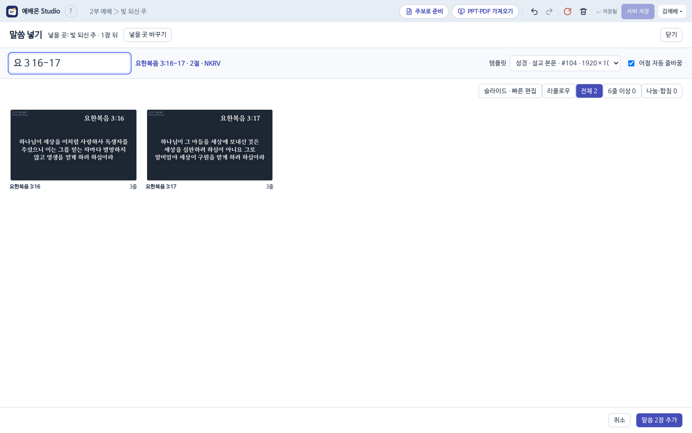

1. 편집 칸 아래 손잡이의 [[성경]](<kbd>Alt B</kbd>)을 열어요. 문서를 열지 않아도 찾고 미리 볼 수 있고, [[말씀 추가]]만 문서를 연 뒤에 돼요.
2. `창 1 1`, `요 3 16-18`처럼 책 줄임말과 장·절을 쳐요.
3. 어절 단위로 자동 줄바꿈된 미리보기를 보고 [[!말씀 추가]]. 서식은 검색칸 아래 작은 서식 칸에서 바꿀 수 있어요(평소엔 기본 서식). 장을 두 번 누르면 빠른 편집, [[리플로우]]는 모든 장의 글을 한 줄씩 고치는 보기예요. 6줄 넘는 장이나 나누고 합친 장이 있을 때만 [[6줄 이상]]·[[나눔·합침]] 걸러 보기가 나타나요.

> [!NOTE]
> 고른 템플릿은 다음에도 기억해요. 주보로 준비에서 만드는 말씀 장도 같은 본문 자료를 써요.
