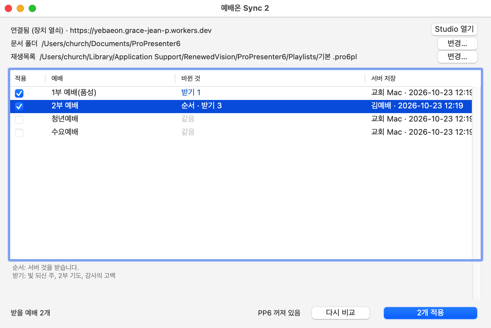
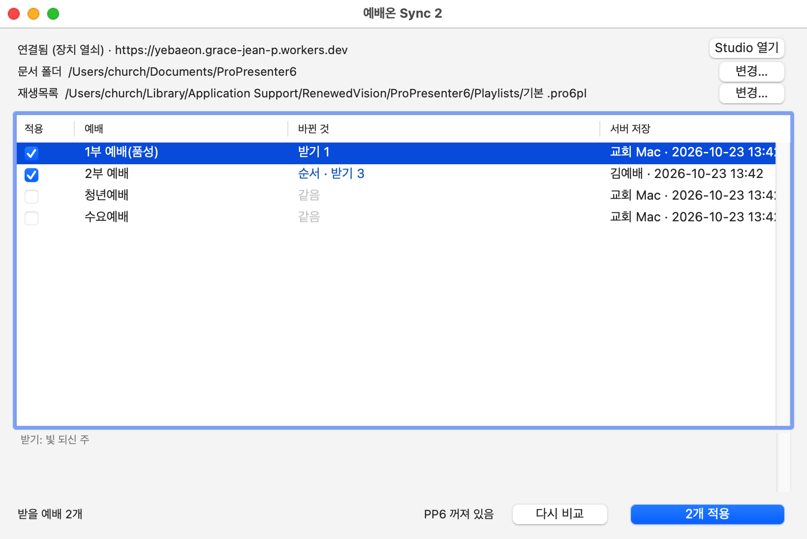

## 매번 하는 일

1. 교회 Mac을 켜면 **예배온 Sync 2**가 저절로 열리고 서버와 비교해요. (켜 있는 동안 15분마다 다시 확인해요.)
2. 표에서 체크된 예배를 확인해요. 줄을 누르면 표 아래에 받을 문서 이름이 나와요.
3. [[!N개 적용]]을 눌러요. 받을 것과 올릴 것(Mac에서 고친 문서, Mac에서 만든 새 문서)을 함께 해요.
4. ProPresenter를 켜요.

## 표 읽는 법

| 바뀐 것 | 뜻 |
|---|---|
| 같음 | 받을 것 없음 |
| 받기 3 | 서버에서 바뀐 문서 3개를 받아요 |
| 순서 | 예배 순서가 바뀌었어요 |
| 올리기 1 | Mac에서만 고친 문서를 서버로 올려요 |
| 새 문서 1 | Mac에서 만들어 예배에 넣은 문서를 서버로 올려요 |
| 양쪽 수정 | 양쪽에서 고쳤어요. 서버 것을 받고 Mac 것은 서버 보관본·백업에 남겨요 |
| 이력 없음 | 어느 쪽이 맞는지 몰라요. 관리자가 정리 창에서 정해요 |

## 이럴 땐

- 방금 웹에서 고쳤다면 [[다시 비교]]를 먼저 눌러요.
- 아래에 `PP6 실행 중`이 보이면 단추가 [[PP6 닫으면 적용 (N)]]으로 바뀌어요. 누르면 Mac에 없던 새 문서와 그림은 지금 넣고(받은 그림 폴더가 Finder로 열려요), 이미 있는 문서를 바꾸는 것과 예배 순서는 ProPresenter를 닫을 때 저절로 적용해요. 예배 중에는 그대로 두면 돼요. 취소하려면 [[적용 예약 취소]]를 눌러요.
- ProPresenter가 켜진 채로 새 문서가 라이브러리에 바로 안 보이면 ProPresenter를 한 번 닫았다 켜요.
- ProPresenter를 닫지 않고 Mac을 꺼도 괜찮아요. 다음에 켤 때 ProPresenter가 꺼져 있으면 못 한 올리기와 예약한 적용을 이어서 해요.
- `서버 휴지통 정리` 줄은 서버에서 지운 문서·그림을 Mac에서도 휴지통으로 옮기는 일이에요. 수천 개일 수 있어 처음엔 체크가 꺼져 있어요. 급한 받기를 끝낸 뒤 시간 날 때 체크해 [[적용]]해요.
- 메뉴 막대의 `예배온 최신` / `예배온 대기 n`으로 상태를 볼 수 있어요.

> [!WARNING]
> 이상한 점이 보이면 받지 말고 관리자에게 알려 주세요.

## 백업과 점검 목록

- [[적용]]과 정리 창 동작은 바꾸기 전 Mac 파일을 백업 폴더에 남겨요(최근 10회). 정리 창 아래 [[백업 폴더 열기]]로 보고, [[백업 정리…]]로 가장 최근 적용(되돌리기에 쓰임)만 남기고 나머지를 macOS 휴지통으로 옮겨요.
- 정리 창 [[목록 복사]]를 누르면 확인 필요 목록과 그 항목들의 Mac·서버 상태가 글로 복사돼요. Claude에게 붙여 넣으면 항목마다 어떤 버튼을 누를지 제안받아요.
